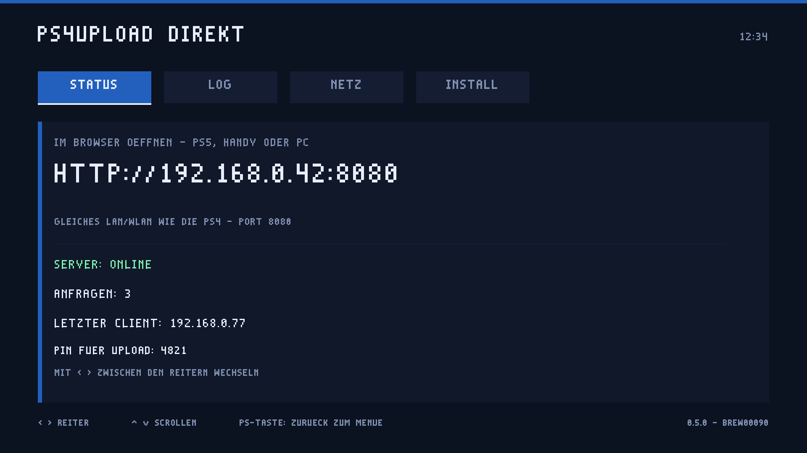
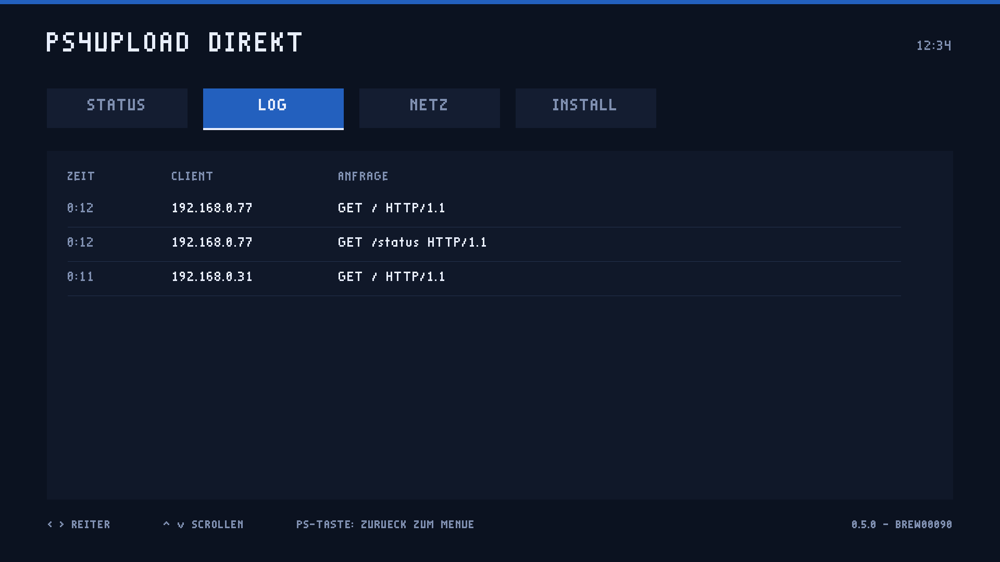
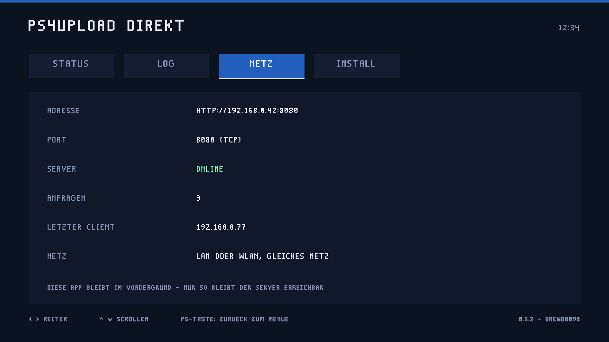
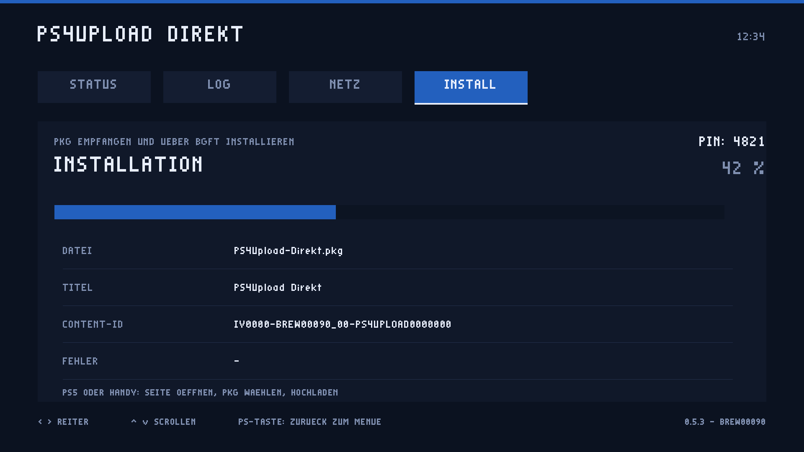

<p align="center">
  
</p>

<h1 align="center">PS4Upload Direkt</h1>

<p align="center">
  <b>PKG-Upload und Installation direkt auf der PS4 – ohne PC im Ablauf.</b><br>
  Die App liefert ihre Webseite selbst im LAN aus; Handy, PS5 oder PC öffnen sie im Browser.
</p>

<p align="center">
  <a href="https://github.com/xsensenmannx/PS4Upload.pkg/releases/latest"></a>
  
  
  
  
</p>

<p align="center">
  
</p>

> **Status 0.5.3 (pre-1.0):** Kompilierung, PKG-Struktur und gerenderte Oberfläche sind auf dem PC geprüft. Der Lauf auf einer PS4 und die BGFT-Installation sind noch ungetestet – deshalb bleibt es bei 0.5.x, bis die Installation auf echter Hardware einmal durchgelaufen ist.

## Die PS4-App

PS4Upload Direkt ist eine native PS4-App (C, OpenOrbis). Sie läuft im Vordergrund und
liefert auf Port `8080` eine Webseite an alle Geräte im selben LAN. Auf dem Fernseher
stehen Adresse, Live-Status, Log und Installationsfortschritt; am Handy oder PS5-Browser
wird die PKG ausgewählt und mit der vierstelligen PIN hochgeladen. Die PS4 prüft die
Datei selbst und übergibt sie an BGFT – ein PC ist nicht beteiligt.

### Screenshots

<table>
  <tr>
    <td align="center" width="33%"><br><sub><b>Log</b> – letzte HTTP-Anfragen</sub></td>
    <td align="center" width="33%"><br><sub><b>Netz</b> – Adresse, Port und Clients</sub></td>
    <td align="center" width="33%"><br><sub><b>Install</b> – Upload, PIN und BGFT-Fortschritt</sub></td>
  </tr>
</table>

### Was die App kann

- **Vier Reiter auf dem TV:** Status, Log, Netz und Install – bedienbar mit dem Controller.
- **Upload vom Handy:** Die PKG wird in 64-KiB-Stücken direkt nach `/data/ps4upload/` gestreamt, ohne sie komplett in den RAM zu legen.
- **PIN-Schutz:** Die PIN steht nur auf dem Fernseher und wird im Header `X-Upload-Pin` übertragen; nach fünf Fehlversuchen ist nur dieser Client eine Minute gesperrt.
- **Prüfung vor BGFT:** Magic `7F 43 4E 54`, Header-Größe, Eintragstabelle und `param.sfo` mit strikten Formaten für `APP_VER`, `TITLE_ID` und `CONTENT_ID`; manipulierte Felder werden mit HTTP 400 abgewiesen.
- **Installation mit Fortschritt:** BGFT-Task mit Live-Anzeige im INSTALL-Reiter und im Kernel-Log.
- **Update-Karte:** Prüft den GitHub-Release, vergleicht mit `/status` und schickt die neue PKG über denselben Upload-Weg. Gleiche oder ältere Versionen werden mit HTTP 409 abgewiesen.
- **Kein Streaming, kein Capture:** Die App macht genau Upload und Installation – sonst nichts.

Wie die PKG gebaut und reproduzierbar geprüft wird, steht unter
[PS4-PKG bauen und verifizieren](#ps4-pkg-bauen-und-verifizieren).

## Installieren und aktualisieren

1. Den [neuesten Release](https://github.com/xsensenmannx/PS4Upload.pkg/releases/latest) öffnen und `PS4Upload-Direkt-BREW00090.pkg` herunterladen.
2. Die PKG auf der PS4 installieren (GoldHEN/HEN; es ist ein unsigniertes Fake-PKG).
3. App starten und die angezeigte Adresse `http://<PS4-IP>:8080` auf Handy, PS5 oder PC öffnen.
4. PKG auswählen, die PIN vom Fernseher eingeben und hochladen.

Ab **0.5.2** übernimmt die Update-Karte auf der Seite den Weg zur nächsten Version.
Wer noch die veröffentlichte **0.5.1** installiert hat, spielt die aktuelle PKG einmal
manuell ein – diese Version hatte die Update-Karte noch nicht.

> **BGFT-Hinweis:** Auf Retail-Firmware prüft BGFT die Paketsignatur. Ob eine selbstgebaute,
> unsignierte PKG angenommen wird, ist weiterhin ungetestet; Stufe und Rückgabecode stehen
> im Kernel-Log.

## PC-Tool: `ps4upload.py`

Zusätzlich liegt ein PC-Tool bei, das `.pkg`-Dateien an eine jailbreakte PS4 schickt und
dort die Installation startet. Die PS4 lädt das Paket über HTTP von diesem Rechner; der
integrierte Server beherrscht HTTP-Range-Requests, die der PS4-Installer zwingend braucht.

Das ist der erste, lauffähige PS4-Stand auf Basis der Idee von
[phantomptr/ps5upload](https://github.com/phantomptr/ps5upload). ps5upload selbst ist ein
PS5-Projekt (PS5-Payload, AVA1-Protokoll); sein Payload läuft nicht auf der PS4. Dieser
Stand nutzt stattdessen die auf der PS4 verbreitete Remote-Package-Installer-API.

## Voraussetzungen für das PC-Tool

- Python 3.10 oder neuer (nur Standardbibliothek, keine Installation nötig)
- PS4 mit Jailbreak und einem Installationsdienst:
  - **Remote Package Installer** (Port `12800`):
    [flatz/ps4_remote_pkg_installer](https://github.com/flatz/ps4_remote_pkg_installer) oder
    [AldySan/ps4_remote_pkg_installer_nextgen](https://github.com/AldySan/ps4_remote_pkg_installer_nextgen)
  - **GoldHEN** mit aktiviertem **BinLoader** (Port `9090`), siehe unten
- PC und PS4 im selben LAN; Port `9898` (PC) muss in der Firewall erlaubt sein.
  Im GoldHEN-Modus zusätzlich die Rückverbindung der Payload erlauben
- PS4-PKG-Dateien (Header `7F 43 4E 54`), auch geteilte Pakete (`_0.pkg`, `_1.pkg`, ...)

## PC-Tool starten

```bash
python ps4upload.py
```

Der Browser öffnet `http://127.0.0.1:9898`. Im Fenster die PS4-IP eintragen, einen
PKG-Pfad (oder einen Ordner) hinzufügen und **Installieren** drücken. Die PS4 lädt die
Datei anschließend selbst herunter und installiert sie.

Dateien können auch direkt mitgegeben werden:

```bash
python ps4upload.py --console 192.168.0.50 "D:\Spiele\CUSA00000.pkg"
```

### Optionen

| Option | Bedeutung |
|---|---|
| `--port 9898` | HTTP-Port, auf dem die PKGs für die PS4 bereitliegen |
| `--host-ip 192.168.0.11` | IP dieses PCs fest vorgeben (überspringt die Netzwerkauswahl) |
| `--list-networks` | Lokale IPv4-Adressen und Adapter anzeigen und beenden |
| `--console 192.168.0.50` | IP der PS4 (sonst im Browser eintragen) |
| `--console-port 12800` | Port des Remote Package Installers |
| `--mode auto\|rpi\|goldhen` | Installationsweg (Standard: `auto`) |
| `--goldhen-port 9090` | Port von GoldHENs BinLoader |
| `--goldhen-payload DATEI` | eigene Installer-Payload (`.bin`) statt der mitgelieferten |
| `--no-browser` | Browser nicht automatisch öffnen |

## Netzwerk auswählen (PC-Tool)

Standardmäßig nimmt PS4Upload die IP der Standardroute. Bei mehreren Adaptern (WLAN,
Ethernet, VPN) im Fenster unter **PC-Netzwerk** das Netz wählen, in dem die PS4 hängt –
die angezeigte URL ist die, die die PS4 tatsächlich lädt. Ist eine PS4-IP eingetragen und
steht sie in einem anderen /24-Netz, erscheint ein Hinweis.

Auf der Konsole zeigt `python ps4upload.py --list-networks` alle Kandidaten:

```text
192.168.0.11    /24 WLAN
10.0.0.5        /24 Ethernet
```

## GoldHEN statt Remote Package Installer (PC-Tool)

PS4Upload kann die Installation über GoldHENs **BinLoader** (Port 9090) anstoßen,
ohne dass auf der PS4 der Remote Package Installer laufen muss.

1. GoldHEN starten und in den GoldHEN-Einstellungen den **BinLoader** aktivieren
   (Port 9090).
2. In PS4Upload unter **Installation** den Modus **GoldHEN Payload (BinLoader)** wählen
   oder **Automatisch** lassen: RPI hat Vorrang, sonst wird GoldHEN benutzt.
3. PKG hinzufügen und **Installieren** drücken. PS4Upload schickt die mitgelieferte
   Installer-Payload an den BinLoader; die PS4 verbindet sich zurück und lädt die PKG
   über die angezeigte URL.
4. Den Fortschritt zeigt die PS4 in ihrer Download-/Benachrichtigungsliste. PS4Upload
   kann ihn in diesem Modus nicht auslesen; der Auftrag steht auf „Installation“.

Die Payload liegt unter `goldhen/payload.bin` und stammt aus
[DirectPackageInstaller](https://github.com/marcussacana/DirectPackageInstaller)
(GPL-3.0, Commit `ca7bade`, SHA-256 siehe [goldhen/README.md](goldhen/README.md)).
Sie wird unverändert weitergegeben; mit `--goldhen-payload` lässt sich eine eigene
`.bin` verwenden. Beim Bauen einer EXE die Payload mit
`--add-data "goldhen/payload.bin;goldhen"` einbinden.

**Grenzen des GoldHEN-Modus**

- Nur einzelne PKG-Dateien. Geteilte Pakete (`_0.pkg`, `_1.pkg`) brauchen weiterhin RPI.
- Kein Fortschritt in PS4Upload und kein Stopp der laufenden Installation. Stoppen
  beendet nur das Senden vor der Übergabe an die PS4.
- Der PC muss für die Rückverbindung der Payload erreichbar sein. Windows-Firewall
  beim ersten Lauf erlauben; der Rückruf-Port ist dynamisch.
- Das Senden eines Payloads führt Code auf der Konsole aus. Nur auf eigenem,
  jailbreakten Gerät und auf eigenes Risiko verwenden.

## Was das PC-Tool kann

- Netzwerkauswahl: WLAN, Ethernet oder VPN wählen; automatisch das Netz, in dem die PS4 hängt
- Installation wahlweise über Remote Package Installer oder GoldHEN-BinLoader
- PKG-Dateien und ganze Ordner hinzufügen; geteilte Pakete werden als ein Auftrag erkannt
- HTTP-Server mit Range-Support (206/416), damit die PS4 Metadaten und Teile lesen kann
- Installationsauftrag über `POST /api/install` (Typ `direct`, mehrere Teile in Reihenfolge)
- Fortschritt, Geschwindigkeit und Restzeit über `POST /api/get_task_progress`
- Warteschlange: PS4-Installationen laufen nacheinander, Stoppen und erneuter Versuch möglich
- Web-Oberfläche auf Deutsch, keine externen Abhängigkeiten
- API-/UI-Zugriff nur von localhost; im LAN nur PKG-Downloads

## PS4 im Browser verwalten: `ps4manage.py`

Zusaetzlich zum Senden von PKGs gibt es einen Verwaltungs-Manager. Er laeuft
auf dem PC und spricht die Dienste, die GoldHEN ohnehin mitbringt: FTP
(Port `2121`) und BinLoader (`9090`).

```bash
python ps4manage.py --console 192.168.0.50
```

Der Browser oeffnet `http://127.0.0.1:9899`:

| Reiter | Inhalt |
|---|---|
| **Spiele** | Installierte Titel aus `/user/appmeta`, Basis/Updates/DLC gruppiert, Icon, Version |
| **Dateien** | `/`, `/data`, `/user`, `/mnt` (USB): Liste, Download, Upload, Ordner anlegen, Loeschen, Umbenennen |
| **Cheats** | `/data/GoldHEN/cheats` lesen, hochladen, loeschen (`.json`, `.shn`) |
| **Payloads** | Payloads aus `payloads/` und `goldhen/` an BinLoader senden; eigene `.bin`/`.elf` direkt senden |
| **Sicherungen** | Save-Daten je Benutzer und Title-ID als ZIP herunterladen (nur lesen) |

Optionen: `--port 9899` (Oberflaeche), `--ftp-port 2121`,
`--goldhen-port 9090`, `--rpi-port 12800`, `--no-browser`.

Grenzen: Die Oberflaeche bindet nur an `127.0.0.1`, weil sie Dateien auf der
Konsole loeschen kann. Geschrieben wird nur unter `/data`, `/user` und `/mnt`.
Spiele starten/beenden, Deinstallation und Power brauchen einen residenten
Payload; Streaming/„Play“ gibt es auf der PS4 nicht. Der vollstaendige
Abgleich mit PS5Upload steht in
[`docs/PS4-PARITY-PS5UPLOAD.md`](docs/PS4-PARITY-PS5UPLOAD.md).

## Grenzen des PC-Tools

- Kein 1:1-Port von ps5upload: kein eigener PS4-Payload (nur die gebündelte
  GoldHEN-Installer-Payload), keine Dateiverwaltung/FTP, keine Spiele-Dumps oder Cheats.
  Nur Senden und Installieren von PKGs.
- Der RPI-Modus braucht einen RPI-kompatiblen Dienst auf Port `12800`. Alternativ
  funktioniert der GoldHEN-BinLoader auf Port `9090` ohne RPI (siehe oben), aber nur
  für einzelne PKG-Dateien.
- PS5 wird nicht unterstützt (dafür ist das Original gedacht).
- **Web-UI und `/api` sind nur über localhost erreichbar.** Im LAN liefert der Server
  ausschließlich `/pkg/...` aus, damit die PS4 laden kann. Wer die Oberfläche von einem
  anderen Gerät braucht, muss sie über einen lokalen Tunnel/Proxy auf dem PC öffnen.

## PS5 Companion (separates MVP 0)

Unter [`ps5companion/`](ps5companion/README.md) liegt eine eigenständige,
browserbasierte Steuerungsebene für ein PS5-Play-Together-Setup im LAN:
Session starten, Einladung per Code/QR teilen, Gäste als Player 2–4 zulassen,
Bereitschaft und Controller-Input in der Lobby sehen.

```bash
python run_ps5companion.py
```

Das ist **keine PS5-PKG und kein Streaming-Host**. Capture, Video/Audio und
virtuelle Controller auf der Konsole sind noch nicht implementiert; die
Simulation macht diese Grenze sichtbar. Die technische Einordnung und die
offenen Hardware-Gates stehen in
[`docs/PS5-HOMEBREW-PKG-FEASIBILITY.md`](docs/PS5-HOMEBREW-PKG-FEASIBILITY.md).

## PS4-Port von PS5Upload: zwei Projekte

Der Port ist in zwei eigenständige Varianten geteilt, die denselben gepinnten
Upstream-Quellstand und denselben Payload-Kern nutzen:

- **[Option B – Payload zuerst](ps4port/option-b-payload/README.md):** Upload und
  Installation im Hintergrund, kleine eigene Web-UI, zuerst umsetzbar.
- **[Option A – Voller Port](ps4port/option-a-full/README.md):** derselbe Payload plus
  Bibliothek, Dateien, Start/Stop und Engine-/Client-Anbindung.

Übersicht, Abgrenzung und Upstream-Pin stehen in [`ps4port/`](ps4port/README.md);
der host-getestete Kern liegt unter [`ps4port/core/`](ps4port/core/README.md).

## PS4-Payload (Anfang des PS5Upload-Pendants)

`payload/ps4/` enthält den nativen PS4-Payload: ein ELF, das aus dem
host-getesteten Kern in `ps4port/core/` gebaut wird, auf Port `9180` einen
HTTP-Dienst bereitstellt und PKGs mit PIN nach `/data/ps4upload/` annimmt.
Enthalten sind `GET /status`, `POST /upload` (mit `HEAD`-Offset und
`?offset=` fortsetzbar), `DELETE /upload`, `GET /files` (Name, Größe, Quote),
`GET /diagnostics` (PIN; freier Platz, Schreib-/Löschtest, PIN-Datei,
AppInstUtil und BGFT-Laden),
eine optionale Quote aus `/data/ps4upload/config.txt`, eine PKG-Prüfung vor
dem Ablegen und ein Diagnose-Log unter `/data/ps4upload/payload.log`. Das ist der Anfang
des Wegs, PS5Uploads Client/Engine gegen die PS4 sprechen zu lassen – kein
fertiger Clone: BGFT-Installation und AVA1 fehlen.

```bash
python tools/ps4payload.py fetch-sdk   # ps4-payload-sdk v0.9 (~6 MB)
python tools/ps4payload.py build       # -> dist/PS4Upload-Payload-0.6.2.elf
python tools/ps4payload.py verify dist/PS4Upload-Payload-0.6.2.elf
python tools/ps4payload.py link-check  # P1-Spike: install.h gegen BGFT linken

python tools/ps4payload-client.py status --host <PS4-IP>
python tools/ps4payload-client.py diagnostics --host <PS4-IP> --pin 4711
python tools/ps4payload-client.py upload spiel.pkg --host <PS4-IP> --pin 4711 --resume
```

Laden über GoldHEN-BinLoader (`9090`, z. B. mit `ps4manage.py`), danach
`http://<PS4-IP>:9180/status`. Details und Grenzen:
[`payload/ps4/README.md`](payload/ps4/README.md).

## PS4-PKG bauen und verifizieren

`ps4app/` enthaelt eine minimale native PS4-App (C, OpenOrbis-Toolchain).
`tools/ps4pkg.py` baut daraus ein installierbares Fake-PKG:

```bash
python -m pip install ziglang        # clang/lld fuer die PS4-Zielplattform
python tools/ps4pkg.py fetch-sdk     # OpenOrbis-Toolchain (~150 MB) nach ps4sdk/
python tools/ps4pkg.py build         # -> dist/PS4Upload-Direkt-BREW00090.pkg
python tools/ps4pkg.py verify dist/PS4Upload-Direkt-BREW00090.pkg
```

Die Version steht in [`version.txt`](version.txt). `tools/version.py sync`
erzeugt daraus `ps4app/version.h` fuer die UI, der Build schreibt dieselbe
Version als `APP_VER` in `param.sfo`, und der Release-Tag ist `v<version>`
(`python tools/version.py tag`).

### Release-Build mit GitHub Actions

[`.github/workflows/build-pkg.yml`](.github/workflows/build-pkg.yml) baut bei
jedem veroeffentlichten Release und auf manuellen Start:

1. Quellen aus dem Tag; `version.txt` muss zum Tag passen, sonst bricht der Job ab
2. gepinnte Werkzeuge: `ziglang==0.17.1`, OpenOrbis-Toolchain v0.5.4 (SHA-256
   im Skript), .NET 8
3. `SOURCE_DATE_EPOCH` kommt aus dem Commit und ersetzt den GP4-Zeitstempel;
   ein zweiter Build muss byte-identisch sein
4. `SHA256SUMS` und die PKG werden an das Release gehaengt (`--clobber`)

Nach dem Download pruefen: `sha256sum -c SHA256SUMS`. Lokal laesst sich der
CI-Build nachstellen, wenn dieselben Werkzeugversionen installiert sind:

```bash
SOURCE_DATE_EPOCH=$(git log -1 --format=%ct) python tools/ps4pkg.py build
```

Die Kette ist ELF -> FSELF (`create-fself`) -> `param.sfo`/`.gp4` -> fPKG
(`PkgTool` aus LibOrbisPkg). Das Paket ist **kein** Sony-signiertes PKG: es hat
Passcode 0 und braucht eine jailbreakte PS4 mit GoldHEN/HEN. Senden laesst es
sich zum Beispiel mit PS4Upload selbst.

Inhalt der App: Beim Start erscheint **auf dem Fernseher** eine Oberflaeche
(CPU-Framebuffer ueber `libSceVideoOut`) mit der LAN-Adresse und dem Live-Status.
Gleichzeitig liefert die PS4 auf Port 8080 eine Web-Seite an PS5, Handy oder PC
im selben LAN/WLAN - ein PC ist nicht beteiligt.

Die App bleibt bewusst im Vordergrund: Eine PS4-App, die in den Hintergrund
wandert (etwa weil der PS4-Browser geoeffnet wird), wird vom System pausiert und
hat kein Netzwerk mehr - genau deshalb ist ps5upload ein Payload. Diese App
zeigt ihre Oberflaeche daher selbst an, statt den Browser zu benutzen.

Die Seite nimmt inzwischen auch eine PKG an: Der Datei-Body wird nach
`/data/ps4upload/` gestreamt, vor der Installation geprueft (Magic, Groesse,
`param.sfo`) und ueber BGFT installiert. Vor dem Upload muss die vierstellige
PIN eingegeben werden, die auf dem Fernseher steht und im Header
`X-Upload-Pin` übertragen wird; falsche Versuche erscheinen im INSTALL-Reiter
und im Kernel-Log, nach fuenf Fehlversuchen ist nur dieser Client eine Minute
gesperrt. Eine Update-Karte auf der Seite prueft den GitHub-Release,
vergleicht ihn mit der installierten Version und schickt die neue PKG ueber
denselben Upload-Weg; gleiche oder aeltere Versionen werden serverseitig
abgewiesen und erst nach Bestaetigung mit `force=1` installiert. Der INSTALL-Reiter auf dem Fernseher
zeigt Upload- und Installationsfortschritt. Ob BGFT eine selbstgebaute,
unsignierte PKG auf Retail-Firmware annimmt, ist ungetestet.

Streaming, Spielsteuerung und Capture sind nicht enthalten. Der Build ist auf
dem PC verifiziert (Kompilierung, Link, PKG-Struktur, PKG-Parser, gerenderte
Oberflaeche); der Lauf auf einer PS4 ist nicht getestet.

## Lizenz

GPL-3.0, siehe [LICENSE](LICENSE). Inspiriert von ps5upload (GPL-3.0) und der
Remote-Package-Installer-API von flatz.
